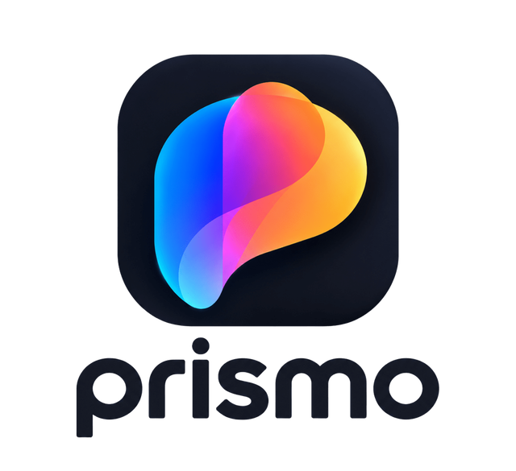

<p align="center">
  <picture>
    <source media="(prefers-color-scheme: dark)" srcset="docs/images/prismo-text-dark.png">
    <source media="(prefers-color-scheme: light)" srcset="docs/images/prismo-text-light.png">
    
  </picture>
</p>

# Prismo

**A fast, offline-first desktop media library for Windows and Linux.**

> Browse your memories like a phone. Manage your files like a desktop.

**Website:** https://prismo.mihirr.in

Prismo is a local media browser inspired by modern mobile galleries — Samsung Gallery, Google Photos, Apple Photos — built for the desktop. It indexes your existing folders and gives you a beautiful, searchable, timeline-based view of your media without ever importing, duplicating, or uploading a single file.

---

## Features (Vision)

- **Timeline view** — all media, chronological, grouped by day/month/year
- **Folder explorer** — browse your actual filesystem, with recursive aggregation
- **Albums** — auto-generated from media-containing folders
- **Instant search** — filename, folder, extension, camera, date, resolution (SQLite FTS5)
- **Favorites, hidden content, soft-delete trash** — gallery essentials, built in
- **Filters** — Photos · Videos · GIFs · RAW · by format · by orientation
- **Background indexing** — non-blocking, incremental, cache-first thumbnails
- **Multiple locations** — unified library across drives, USB, NAS
- **Disconnected drive support** — external drives show as offline, not deleted
- **Viewport virtualization** — only visible thumbnails are decoded
- **Your files stay yours** — Prismo never changes, moves, renames, re-encodes or deletes a file on its own; files change only when you run a file operation yourself

---

## Philosophy

1. **Offline-first** — no account, no login, no telemetry, no cloud, no subscriptions
2. **Non-destructive** — files stay exactly where they are, nothing is ever duplicated
3. **Privacy-first** — everything runs locally, nothing leaves your machine
4. **Architecture over language** — performance comes from cache-first design and async indexing, not the implementation language

---

## Tech Stack

| Layer | Choice |
|---|---|
| UI | JavaFX 25 |
| Core | Java 25 LTS (virtual threads, FFM API) |
| Build | Gradle (Kotlin DSL) |
| Database | SQLite + FTS5 (xerial sqlite-jdbc) |
| Metadata | metadata-extractor (EXIF, HEIF, MP4/QuickTime) |
| Image decoding | ImageIO (JPEG/PNG/BMP/GIF), TwelveMonkeys (WEBP), the bundled FFmpeg (HEIC), embedded previews (RAW) |
| Video | FFmpeg (LGPL build) through JavaCV: playback and thumbnails |
| File monitoring | java.nio.file.WatchService (behind a pluggable abstraction) |
| Logging | SLF4J + Logback |
| Packaging | jlink + jpackage (bundled runtime, no Java installation required) |

Details, versions and reasons: [docs/TECH_STACK.md](docs/TECH_STACK.md).

---

## Status

**Early development: v1.0 MVP in progress** (v0.1 Foundation and v0.5 Core Loop done)

The app runs (`./gradlew run`). What works today:

- **Library and Timeline:** add folders ("Library folders…": add, turn off, remove); Prismo indexes them, makes thumbnails in the background (real thumbnails for videos too, with a play badge and the length) and shows everything on a date-grouped Timeline. Files you add, rename, move or delete in your folders show up in Prismo by themselves within a second or two.
- **Viewer:** click a photo (or move with the arrow keys and press Enter): zoom, pan, rotate, slideshow, full screen (the controls and the pointer hide after 2.5 s without mouse movement), previous / next buttons at the edges.
- **Videos** play in the app (MP4, M4V, MOV, MKV, WebM, AVI; phone videos upright): skip ±10 s and ±5 s, volume and mute, speed 0.5×–2× (the sound keeps its pitch), loop, frame steps while paused, a choice of sound track when there are several, and subtitles (an `.srt` file next to the video, any `.srt` you pick with "Choose subtitle file…", or text subtitles inside MKV / MP4) with a delay you can shift by 0.1 s. A thin bar on a video's thumbnail shows how far you watched (full and in another colour once watched), and the video carries on where you left it.
- **Info panel** (I, or the Info button in the viewer): the file's details, a photo's camera settings and GPS position, a video's formats and tracks.
- **Right-click menus** on the grids and in the viewer, each item with its shortcut: favorite, hide, Trash, Show in folder, Open with default app, Copy (puts the file on the clipboard, to paste in File Explorer), Info.
- **Search and Filters:** the search box (Ctrl+F) finds files by name, folder, camera, date or resolution. Filter (Photos, Videos, JPEG, Portrait, Screenshots…) and sort (date taken / modified / added, name, size, resolution) the Timeline and search results.
- **Collections tab:** Folders (a folder tree, with or without subfolders), Albums (one per folder), Favorites, Recently Added, Hidden and Trash. F / H / Delete favorite, hide or move something to Trash; "Delete permanently" (from Trash, after asking) moves the file to the Recycle Bin (deletes it for good where there is none; the question says which).
- **Hidden files:** files marked Hidden in Windows File Explorer show only on Collections › Hidden (a Settings switch shows them everywhere instead). The right-click menu can set or clear that Windows mark, and in Settings Prismo's own Hide can be set to set the mark too ("Both ways").
- **HEIC and RAW:** HEIC / HEIF photos (iPhones, many Android phones) through the bundled FFmpeg, and RAW files (CR2, CR3, NEF, ARW, DNG, ORF, RW2, RAF and more) through the JPEG preview the camera stores inside: thumbnails, the viewer, the date taken and the camera settings.
- **Selecting many:** Ctrl-click, Shift-click, Shift + arrow keys or Ctrl+A; a bar at the bottom then favorites, hides, trashes, copies or moves them all at once.
- **File operations:** Rename (F2) and Move to folder… (with a question when a name is already taken: keep both or skip); Prismo follows the file, favorites and all.
- **Offline and network folders:** when a library folder can't be reached (an unplugged drive, a network share that's off), a banner says so and its tiles are greyed out; nothing is lost and everything comes back with the drive. Network folders are checked every 10 minutes instead of watched live.
- **Settings** (the Settings button in the top bar, or Ctrl+,): the look (Light, Dark, AMOLED black, or Follow system, which changes with Windows), hidden items, ignored folders (node_modules, .git and the like are skipped), Timeline date headers (smart, day, week, month or year), thumbnail CPU use and cache size (with Clear thumbnails), the keyboard shortcuts, and About. The title bar follows the look on Windows. Every setting, the window's size and place, the thumbnail size, Filters + Sort, "Include subfolders" and the video volume / mute / speed are kept after a restart.

Done so far: Project Setup, Database Layer, Media Indexer, Thumbnail Cache, Timeline, Viewer, Search, Filesystem Watcher, Collections, and the pre-packaging work (video player, looks, app icon, viewer and video features, HEIC, RAW, selection, file operations, offline folders, more settings). Next: Packaging. No installer yet.

**Windows first:** Prismo is built and tested on Windows. It is written to work on Linux too (the Windows-only parts, like the Hidden mark and the dark title bar, switch off there), but it has not been run on Linux yet, so it may not behave properly there.

To try it on Windows without touching your normal Prismo data: `.\run-locally.bat --test` ([docs/RUN_LOCALLY.md](docs/RUN_LOCALLY.md), with a checklist of things to try by hand).

- [Project Outline](docs/PROJECT.md) — full design document
- [Tech Stack](docs/TECH_STACK.md) — libraries and how the parts fit together
- [Development Guide](docs/DEVELOPMENT.md) — development workflow, rules, and conventions

---

## Keyboard shortcuts

Right-click menus and button tooltips show these too.

**Main window (viewer closed)**

| Key | Does |
|---|---|
| Ctrl+F | Search box |
| Ctrl+1 / Ctrl+2 | Timeline / Collections tab |
| Ctrl+, | Settings |
| Ctrl + mouse wheel | Bigger / smaller thumbnails (on a grid) |

**Grid (Timeline, search results, Collections pages)**

| Key | Does |
|---|---|
| Arrow keys | Move between items |
| Enter | Open in the viewer |
| F / H / Delete | Favorite / hide / move to Trash (on Hidden: unhide; on Trash: delete permanently, after asking) |
| Ctrl+C | Copy the file (paste it in File Explorer or another app) |
| F2 | Rename |
| I or Alt+Enter | Open in the viewer with the Info panel |

**Selecting (on a grid)**

| Key | Does |
|---|---|
| Ctrl + click, or Space | Select or unselect one |
| Shift + click | Select everything up to here |
| Shift + arrow keys | Select while moving |
| Ctrl+A | Select all |
| F / H / Delete / Ctrl+C | Do it to every selected item |
| Esc | Clear the selection |

**Viewer (photos and videos)**

| Key | Does |
|---|---|
| Page Up / Page Down | Previous / next item |
| Left / Right | Previous / next item (photos; in a video they skip 5 s) |
| Esc | Close the Info panel, leave full screen, then close the viewer |
| F11, double-click a video | Full screen |
| I | Info panel |
| F / H / Delete, Ctrl+C, F2 | As on the grid |
| Space | Slideshow (photos) |
| R | Rotate (view only, the file isn't changed) |
| + / - / 0 | Zoom in / out / fit to window |
| Double-click a photo | Zoom to 100 %, or back to fit |

**Videos**

| Key | Does |
|---|---|
| Space, or click the video | Play / pause |
| J / L | Back / forward 10 s |
| Left / Right | Back / forward 5 s |
| Home | From the start |
| Up / Down | Volume |
| M | Mute |
| [ / ] | Slower / faster (0.5× to 2×) |
| , / . | One picture back / on (while paused) |
| C | Next subtitles (an `.srt` next to the video or a track inside it) |
| Z / X | Subtitles 0.1 s earlier / later |
| A | Next sound track |

---

## Roadmap

### v0.1 — Foundation

```
Project Setup · Database Layer · Media Indexer
```

### v0.5 — Core Loop

Prove the core loop works and feels fast:

```
Thumbnail Cache · Timeline · Viewer · Search · Filesystem Watcher
```

### v1.0 — MVP

Everything above, plus the baseline features that make it feel like a real gallery:

```
Collections (Folder Explorer + Albums) · Packaging
Favorites · Hidden (OS-level + Ignored Paths) · Trash
Filters · Sort · Metadata Panel · Selection Mode · File Operations · Multiple Locations
HEIC support · RAW previews · Video Watch Progress
```

---

## Project Structure

```
prismo/
├── assets/
│   └── branding/               # The original logo artwork (the app and this README use their own copies)
├── docs/
│   ├── PROJECT.md              # What Prismo is: features, scope, roadmap
│   ├── TECH_STACK.md           # Libraries, versions, and implementation approach
│   ├── DEVELOPMENT.md          # Development workflow, rules, and conventions
│   ├── RUN_LOCALLY.md          # Running Prismo from the source, with separate test data, and a hand-test checklist
│   └── images/                 # The logo with its name, for this README (light and dark backgrounds)
├── frontend/                   # The Prismo website (React + Vite), live at prismo.mihirr.in (Vercel): its own package.json, separate from the app build; sample photos in public/photos with credits.json
├── gradle/
│   ├── libs.versions.toml      # Every dependency version, in one place
│   └── wrapper/                # Gradle wrapper (pinned Gradle version + checksum)
├── src/
│   ├── main/
│   │   ├── java/io/github/mihirvr/prismo/
│   │   │   ├── Launcher.java       # Entry point (main)
│   │   │   ├── PrismoApp.java      # JavaFX application: startup, main window, shutdown
│   │   │   ├── platform/           # OS-specific code: OS detection, app data/cache/log folders, file reads that never lock a file (+ CR3 EXIF), dark title bar (Windows), the Windows Hidden mark, Show in folder, network drives, can a folder be reached, running ffmpeg as a separate program
│   │   │   ├── db/                 # SQLite: connections, single writer thread, migrations, settings, library folders, video watch positions
│   │   │   ├── index/              # Media indexer: folder walk, metadata reading, batched writes, progress; removes gone files, follows moves; ignored folders; rename / move
│   │   │   ├── thumbs/             # Thumbnail cache: subsampled decode, EXIF rotation, video frames via ffmpeg, HEIC (ffmpeg) and RAW previews, on-screen-first queue, cache size / clear
│   │   │   ├── ui/                 # Timeline: virtualized grid of date-grouped rows, thumbnail tiles (watch-progress bar), loader, keyboard focus; shared Filters + Sort; date grouping; selection; offline folders; page scopes, item actions, album grid; looks (themes), icons, menus, file items (Show in folder, Copy…), window and dialog placement
│   │   │   ├── search/             # Search: query words → FTS5/LIKE SQL, background search thread, search box
│   │   │   ├── collections/        # Collections tab: folder tree, albums, Favorites / Recently Added / Hidden / Trash, favorite-hide-trash-delete actions, hide modes, Library folders dialog
│   │   │   ├── settings/           # The Settings window: pages for the look, hidden items, ignored folders, Timeline, performance, keyboard shortcuts, About
│   │   │   ├── watch/              # Filesystem watcher: whole-tree (Windows) or per-folder watching, debounced batches
│   │   │   ├── video/              # Video player on FFmpeg (JavaCV): picture + sound threads, sound-card clock, speed, sound and subtitle tracks, subtitles (.srt)
│   │   │   └── viewer/             # Media viewer: full-size stills, zoom/pan/rotate, slideshow, full screen, video controls, Info panel
│   │   └── resources/
│   │       ├── logback.xml         # Logging setup (rotating log file)
│   │       ├── app.properties      # Version (filled in by the build) and website, for Settings › About
│   │       ├── db/migration/       # Numbered schema scripts (V1__..., V2__..., V3__search = FTS5 index, V4__os_hidden = the Windows Hidden mark, V5__reread_raw = read RAW metadata again)
│   │       └── ui/
│   │           ├── prismo.css      # The app's stylesheet (the Light look; every colour is a named colour)
│   │           ├── theme-dark.css  # The Dark look: redefines the named colours
│   │           ├── theme-amoled.css # The AMOLED black look (on top of Dark)
│   │           ├── icon/           # The app icon in 9 sizes (16–256 px), for the window, taskbar and dialogs
│   │           └── logo/           # The Prismo logo with its name, for light and dark backgrounds (in-app copies)
│   └── test/
│       ├── java/...                # Unit tests, mirroring the main packages (+ testing/ shared helpers)
│       └── resources/              # Test-only logging config and test migration scripts
├── build.gradle.kts            # Build: Java 25 toolchain, JavaFX, dependencies, run/test settings
├── settings.gradle.kts         # Project name + JDK auto-download plugin
├── gradlew / gradlew.bat       # Run Gradle without installing it (./gradlew build)
├── .gitattributes              # Line endings (keeps gradlew working on Linux)
├── run-locally.bat           # Windows: build and start Prismo, with your normal data or a separate test folder
├── .gitignore
├── LICENSE
└── README.md
```

Build and run: `./gradlew run` · tests: `./gradlew test`.

New packages appear as features land (packaging, …).

---

## Contributing

Prismo is in its earliest stages. Contributions are welcome once the project has a buildable skeleton.

In the meantime, feel free to open an issue to discuss ideas, suggest features, or report problems with the design.

---

## License

This project is licensed under the [MIT License](LICENSE).
