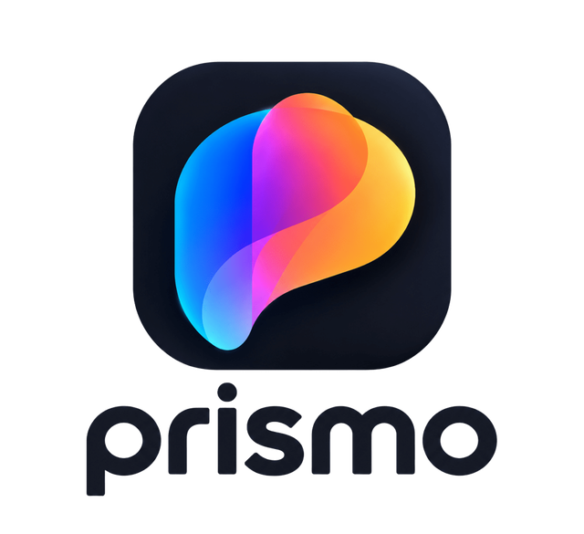

<p align="center">
  <picture>
    <source media="(prefers-color-scheme: dark)" srcset="docs/images/prismo-text-dark.png">
    <source media="(prefers-color-scheme: light)" srcset="docs/images/prismo-text-light.png">
    
  </picture>
</p>

# Prismo

**A fast, offline-first desktop media library for Windows and Linux.**

> Browse your memories like a phone. Manage your files like a desktop.

**Website:** https://prismo.mihirr.in · **Install:** [docs/INSTALL.md](docs/INSTALL.md)

Prismo is a local media browser inspired by modern mobile galleries — Samsung Gallery, Google Photos, Apple Photos — built for the desktop. It indexes your existing folders and gives you a beautiful, searchable, timeline-based view of your media without ever importing, duplicating, or uploading a single file.

---

## Features (Vision)

- **Timeline view** — all media, chronological, grouped by day/month/year
- **Folder explorer** — browse your actual filesystem, with recursive aggregation
- **Albums** — auto-generated from media-containing folders
- **Instant search** — filename, folder, extension, camera, date, resolution (SQLite FTS5)
- **Favorites, hidden content, soft-delete trash** — gallery essentials, built in
- **Filters** — Photos · Videos · GIFs · RAW · by format · by orientation
- **Background indexing** — non-blocking, incremental, cache-first thumbnails
- **Multiple locations** — unified library across drives, USB, NAS
- **Disconnected drive support** — external drives show as offline, not deleted
- **Viewport virtualization** — only visible thumbnails are decoded
- **Your files stay yours** — Prismo never changes, moves, renames, re-encodes or deletes a file on its own; files change only when you run a file operation yourself

---

## Philosophy

1. **Offline-first** — no account, no login, no telemetry, no cloud, no subscriptions
2. **Non-destructive** — files stay exactly where they are, nothing is ever duplicated
3. **Privacy-first** — everything runs locally, nothing leaves your machine
4. **Architecture over language** — performance comes from cache-first design and async indexing, not the implementation language

---

## Tech Stack

| Layer | Choice |
|---|---|
| UI | JavaFX 25 |
| Core | Java 25 LTS (virtual threads, FFM API) |
| Build | Gradle (Kotlin DSL) |
| Database | SQLite + FTS5 (xerial sqlite-jdbc) |
| Metadata | metadata-extractor (EXIF, HEIF, MP4/QuickTime) |
| Image decoding | ImageIO (JPEG/PNG/BMP/GIF), TwelveMonkeys (WEBP), the bundled FFmpeg (HEIC), embedded previews (RAW) |
| Video | FFmpeg (LGPL build) through JavaCV: playback and thumbnails |
| File monitoring | java.nio.file.WatchService (behind a pluggable abstraction) |
| Logging | SLF4J + Logback |
| Packaging | jlink + jpackage (bundled runtime, no Java installation required) |

Details, versions and reasons: [docs/TECH_STACK.md](docs/TECH_STACK.md).

---

## Status

**Version 1.3.1** (1.0.0 was the first release: v0.1 Foundation, v0.5 Core Loop and the v1.0 MVP done; 1.0.1 fixed thumbnails and library folders; 1.1.0 to 1.3.1 are described below). Windows first; the Linux package is an early preview.

The app runs (`./gradlew run`).

**1.3.1:** the Filters bar fits a smaller window: the People and Categories buttons show their icon with a short
text (All, a number, None; the tooltip says it in full), and when room runs out the word "Sort" steps aside first, then
"Go to date" becomes its icon, then the thumbnail-size slider hides (Ctrl + mouse wheel still resizes), and in a
half-screen window People, Categories and the sort direction show as icons. Nothing is cut off mid-word.

**1.3.0:** **Categories** (Nature, Documents, Portraits, anything you like), made by hand
exactly like People: right-click one item, a selection or a whole folder › Categories… and tick the categories; type a
new name there to add one (or use New category on Collections › Categories). A photo can have people and categories
at the same time. A Categories filter next to People shows the items in the categories ticked (all of them together or
any of them), or the items with no category yet; both filters together show only what matches both. The Info panel
lists an item's categories. **Choose where the sound plays**: when the PC has more than one sound device (laptop
speakers, headphones, a TV), the video's sound menu and right-click › Audio › Play sound on list them; the choice holds
for every video until Prismo is closed, and the next start uses the system's default device again. The seek-bar
preview now shows the picture under the mouse at once (it is made first), even while the mouse rests, has many more
pictures on long videos, takes the exact frame on short clips, and stays small for phone videos. R turns a video's
view a quarter turn, as for photos (the file isn't changed; the next item starts upright). A slideshow started in a
window goes full screen and comes back to the window when it stops. Drag a photo (when it isn't zoomed in), a video,
or a tile of the filmstrip out of the viewer into another app or a folder, as from the grid (a folder gets a copy).

**1.2.1:** hovering a video's seek bar shows a **preview picture** of that moment
with its time, in a see-through glass card that follows the mouse (the pictures are made in the background when the
video opens, spread over the whole video first, then filled in; until the first one is ready the card shows only the
time). A click just above or below the thin seek bar now seeks too, and the bar gets thicker under the pointer. In a
window the filmstrip always stays; it hides on its own only in full screen. A **slideshow** now shows only the photos:
no bars, no filmstrip, and moving the mouse brings nothing back; any click or key press only stops it (it doesn't also
open or step anything). Around a photo or video the viewer is pitch black in every theme. In Library folders a click
anywhere on a folder's row turns it on or off (Remove… still only removes).

**1.2.0:** **People tags**, all done by hand (Prismo never looks at the
pictures, and nothing leaves your PC): right-click one item, a selection or a whole folder › People… and tick who is
in them; type a new name there to add a person on the spot (or use New person on Collections › People). For a
folder, pick which subfolders count. Ticking only adds; untick to remove. A
People filter next to Types shows the items of the people ticked, all of them together or any of them, or the items
nobody is tagged in yet. Right-click menus are flat again (no File submenu: Show in folder and Copy are on the menu
itself). Drag a photo or video (or a selection) out of Prismo into another app, a browser page such as WhatsApp Web, or
a folder, as from File Explorer (a folder gets a copy). Fixes: video thumbnails on big libraries were made very slowly
(each try decoded every frame up to the chosen time; now only key frames are decoded, which is much faster on
heavy videos such as HEVC), and the progress note now says how many could not be made; video thumbnails are always a frame of the video (1.1.0 used a cover picture stored in
the file, which in downloaded series is often the encoder group's logo); a click outside an open menu closes it and
does nothing else; menu shortcut keys are in the muted colour; the filmstrip's tiles fade out at the edges in full
screen too; Windows' "Open with" list shows "Prismo" after an upgrade; MKV and WebM tiles show the video's
length (read from the file's own header; existing ones are read once more after the update).

**1.1.0:** the Timeline tab is now **Grid**, with a View menu:
Timeline (date headers), Folders (root files and folders as separate blocks, with an Arrange menu for their order)
and All files. Names sort the natural way (1, 2, 10) with 0-9 / A-Z / # headers. A Types menu replaces the JPEG /
PNG / HEIC / WEBP filters. The scroll bar shows the date, letter or folder you are at; tiles have a name tooltip and
a badge for files hidden in File Explorer. Right-click menus have submenus; the Collections tree has guide lines. A
filmstrip in the viewer (hides when the mouse rests). Opening a photo or video from File Explorer (Open with ›
Prismo) shows it at once in a small viewer without the library. Keys follow YouTube, then VLC (see below). Video
thumbnails use a well-lit frame about 10 % in instead of the frame at 1 s (old ones are made again once). Fewer
labels: no status line full of counts (a small note shows only while work runs), and shorter hints.

What works in 1.0.1:

- **Library and Timeline:** add folders ("Library folders…": add, turn off, remove); Prismo indexes them, makes thumbnails in the background (real thumbnails for videos too, with a play badge and the length) and shows everything on a date-grouped Timeline. Files you add, rename, move or delete in your folders show up in Prismo by themselves within a second or two.
- **Viewer:** click a photo (or move with the arrow keys and press Enter): zoom, pan, rotate, slideshow, full screen (the controls and the pointer hide after 2.5 s without mouse movement), previous / next buttons at the edges.
- **Back and Forward, like a web browser:** the mouse's side buttons (or Alt+Left / Alt+Right) go back to the tab, Collections page, folder, album or search you were on before, and forward again. In the viewer, Back closes it, and Forward opens it again on the same photo or video.
- **Videos** play in the app (MP4, M4V, MOV, MKV, WebM, AVI; phone videos upright): skip ±10 s and ±5 s, volume and mute, speed 0.5×–2× (the sound keeps its pitch), loop, frame steps while paused, a choice of sound track when there are several, and subtitles (an `.srt` file next to the video, any `.srt` you pick with "Choose subtitle file…", or text subtitles inside MKV / MP4) with a delay you can shift by 0.1 s. Subtitles sit centred near the bottom on a black box that fits the text; the box can be see-through (25 / 50 / 75 %), solid, or left out (then the text gets a dark outline), in Settings › Video or the Subtitles menu. Each video remembers the sound track, subtitles and delay you picked, and a video you haven't set up starts in the sound and subtitle language you picked last. A thin bar on a video's thumbnail shows how far you watched (full and in another colour once watched), and the video carries on where you left it.
- **Info panel** (I, or the Info button in the viewer): the file's details, a photo's camera settings and GPS position, a video's formats and tracks.
- **Right-click menus** on the grids and in the viewer, each item with its shortcut: favorite, hide, Trash, Show in folder, Open with default app, Copy (puts the file on the clipboard, to paste in File Explorer), Info.
- **Search and Filters:** the search box (Ctrl+F) finds files by name, folder, camera, date or resolution. Filter (Photos, Videos, JPEG, Portrait, Screenshots…) and sort (date taken / modified / added, name, size, resolution) the Timeline and search results.
- **Collections tab:** Folders (a folder tree, with or without subfolders), Albums (one per folder), Favorites, Recently Added, Hidden and Trash. F / H / Delete favorite, hide or move something to Trash; "Delete permanently" (from Trash, after asking) moves the file to the Recycle Bin (deletes it for good where there is none; the question says which).
- **Hidden files:** files marked Hidden in Windows File Explorer show only on Collections › Hidden (a Settings switch shows them everywhere instead). The right-click menu can set or clear that Windows mark, and in Settings Prismo's own Hide can be set to set the mark too ("Both ways").
- **HEIC and RAW:** HEIC / HEIF photos (iPhones, many Android phones) through the bundled FFmpeg, and RAW files (CR2, CR3, NEF, ARW, DNG, ORF, RW2, RAF and more) through the JPEG preview the camera stores inside: thumbnails, the viewer, the date taken and the camera settings.
- **Selecting many:** Ctrl-click, Shift-click, Shift + arrow keys or Ctrl+A; a bar at the bottom then favorites, hides, trashes, copies or moves them all at once.
- **File operations:** Rename (F2) and Move to folder… (with a question when a name is already taken: keep both or skip); Prismo follows the file, favorites and all.
- **Offline and network folders:** when a library folder can't be reached (an unplugged drive, a network share that's off), a banner says so and its tiles are greyed out; nothing is lost and everything comes back with the drive. Network folders are checked every 10 minutes instead of watched live.
- **Settings** (the Settings button in the top bar, or Ctrl+,): the look (Light, Dark, AMOLED black, or Follow system, which changes with Windows), hidden items, ignored folders (node_modules, .git and the like are skipped), Timeline date headers (smart, day, week, month or year), the subtitle background, thumbnail CPU use and cache size (with Clear thumbnails), the keyboard shortcuts, and About. The title bar follows the look on Windows. Every setting, the window's size and place, the thumbnail size, Filters + Sort, "Include subfolders", the video volume / mute / speed and the sound and subtitle languages picked last are kept after a restart.

Done so far: Project Setup, Database Layer, Media Indexer, Thumbnail Cache, Timeline, Viewer, Search, Filesystem Watcher, Collections, and the pre-packaging work (video player, looks, app icon, viewer and video features, HEIC, RAW, selection, file operations, offline folders, more settings). Packaging is built: a Windows installer (`.exe`, no admin rights needed) and a Linux `.deb`, made by `./gradlew installer` and by GitHub Actions. Download it from the [Releases page](https://github.com/mihirvr/prismo/releases). How to install: [docs/INSTALL.md](docs/INSTALL.md). Where the database, thumbnail cache and logs are kept: [docs/INSTALL.md, data and cache](docs/INSTALL.md#where-prismo-keeps-its-data-and-cache).

**Windows first:** Prismo is built and tested on Windows. It is written to work on Linux too (the Windows-only parts, like the Hidden mark and the dark title bar, switch off there), but it has not been run on Linux yet, so it may not behave properly there.

To try it on Windows without touching your normal Prismo data: `.\run-locally.bat --test` ([docs/RUN_LOCALLY.md](docs/RUN_LOCALLY.md), with a checklist of things to try by hand).

- [Project Outline](docs/PROJECT.md) — full design document
- [Tech Stack](docs/TECH_STACK.md) — libraries and how the parts fit together
- [Development Guide](docs/DEVELOPMENT.md) — development workflow, rules, and conventions
- [Installing Prismo](docs/INSTALL.md) — Windows and Linux, updating, uninstalling, and fixes when something goes wrong

---

## Keyboard shortcuts

As in the code on `main` (1.1.0): YouTube's keys first, VLC's for the rest. Right-click menus, button tooltips and
Settings › Keyboard shortcuts show these too. (1.0.1 used F / H for favorite / hide, A for the sound track, C for the
next subtitles and Z / X for the delay.)

**Main window (viewer closed)**

| Key | Does |
|---|---|
| Ctrl+F or / | Search box |
| Ctrl+1 / Ctrl+2 | Grid / Collections tab |
| Ctrl+, | Settings |
| Ctrl + mouse wheel | Bigger / smaller thumbnails (on a grid) |
| Alt+Left / Alt+Right, or the mouse's back / forward side buttons | Back / forward: the tab, Collections page, folder, album or search you were on before (like a web browser) |

**Grid (the Grid tab, search results, Collections pages)**

| Key | Does |
|---|---|
| Arrow keys | Move between items |
| Enter | Open in the viewer |
| Ctrl+D / Ctrl+H / Delete | Favorite / hide / move to Trash (on Hidden: unhide; on Trash: delete permanently, after asking) |
| Ctrl+C | Copy the file (paste it in File Explorer or another app) |
| F2 | Rename |
| I or Alt+Enter | Open in the viewer with the Info panel |

**Selecting (on a grid)**

| Key | Does |
|---|---|
| Ctrl + click, or Space | Select or unselect one |
| Shift + click | Select everything up to here |
| Shift + arrow keys | Select while moving |
| Ctrl+A | Select all |
| Ctrl+D / Ctrl+H / Delete / Ctrl+C | Do it to every selected item |
| Esc | Clear the selection |

**Viewer (photos and videos)**

| Key | Does |
|---|---|
| Page Up / Page Down, Shift+P / Shift+N | Previous / next item |
| Left / Right | Previous / next item (photos; in a video they skip 5 s) |
| Esc | Close the Info panel, leave full screen, then close the viewer |
| Alt+Left, or the mouse's back button | Close the viewer (Alt+Right or the forward button opens it again on the same item) |
| F or F11, double-click a video | Full screen |
| I | Info panel |
| Ctrl+D / Ctrl+H / Delete, Ctrl+C, F2 | As on the grid |
| Space | Slideshow (photos) |
| R | Rotate (view only, the file isn't changed; videos too since 1.3.0) |
| + / - / 0 | Zoom in / out / fit to window |
| Double-click a photo | Zoom to 100 %, or back to fit |

**Videos**

| Key | Does |
|---|---|
| Space or K, or click the video | Play / pause |
| J / L | Back / forward 10 s |
| Left / Right | Back / forward 5 s |
| Ctrl+Left / Ctrl+Right | Back / forward 1 minute |
| 0 to 9 | Jump to 0 % to 90 % of the video |
| Home / End | The start / the end |
| Up / Down | Volume |
| M | Mute |
| < / > (Shift+, / Shift+.) | Slower / faster (0.5× to 2×) |
| [ / ] | A little slower / faster |
| = | Normal speed |
| , / . | One picture back / on (while paused) |
| Shift+L | Loop |
| C | Subtitles on / off |
| V | Next subtitles (an `.srt` next to the video or a track inside it) |
| G / H | Subtitles 0.1 s earlier / later |
| B | Next sound track |
| T | Show the time |

---

## Roadmap

### v0.1 — Foundation

```
Project Setup · Database Layer · Media Indexer
```

### v0.5 — Core Loop

Prove the core loop works and feels fast:

```
Thumbnail Cache · Timeline · Viewer · Search · Filesystem Watcher
```

### v1.0 — MVP

Everything above, plus the baseline features that make it feel like a real gallery:

```
Collections (Folder Explorer + Albums) · Packaging
Favorites · Hidden (OS-level + Ignored Paths) · Trash
Filters · Sort · Metadata Panel · Selection Mode · File Operations · Multiple Locations
HEIC support · RAW previews · Video Watch Progress
```

---

## Project Structure

```
prismo/
├── .github/workflows/
│   └── package.yml             # GitHub Actions: builds the Windows .exe and Linux .deb (on a v* tag or by hand), installs and starts the .deb
├── assets/
│   └── branding/               # The original logo artwork (the app and this README use their own copies)
├── docs/
│   ├── PROJECT.md              # What Prismo is: features, scope, roadmap
│   ├── TECH_STACK.md           # Libraries, versions, and implementation approach
│   ├── DEVELOPMENT.md          # Development workflow, rules, and conventions
│   ├── RUN_LOCALLY.md          # Running Prismo from the source, with separate test data, and a hand-test checklist
│   ├── INSTALL.md              # Installing, updating and uninstalling on Windows and Linux; what Linux needs; troubleshooting
│   └── images/                 # The logo with its name, for this README (light and dark backgrounds)
├── frontend/                   # The Prismo website (React + Vite), live at prismo.mihirr.in (Vercel): its own package.json, separate from the app build; sample photos in public/photos with credits.json
├── gradle/
│   ├── libs.versions.toml      # Every dependency version, in one place
│   └── wrapper/                # Gradle wrapper (pinned Gradle version + checksum)
├── src/
│   ├── main/
│   │   ├── java/io/github/mihirvr/prismo/
│   │   │   ├── Launcher.java       # Entry point (main)
│   │   │   ├── PrismoApp.java      # JavaFX application: startup, main window, shutdown
│   │   │   ├── Navigation.java     # Back / Forward like a web browser: the mouse's side buttons and Alt+Left / Alt+Right
│   │   │   ├── platform/           # OS-specific code: OS detection, app data/cache/log folders, file reads that never lock a file (+ CR3 EXIF), dark title bar (Windows), the Windows Hidden mark, Show in folder, network drives, can a folder be reached, running ffmpeg as a separate program
│   │   │   ├── db/                 # SQLite: connections, single writer thread, migrations, settings, library folders, video watch positions, the sound track / subtitles picked in each video
│   │   │   ├── index/              # Media indexer: folder walk, metadata reading, batched writes, progress; removes gone files, follows moves; ignored folders; rename / move
│   │   │   ├── thumbs/             # Thumbnail cache: subsampled decode, EXIF rotation, well-lit video frames via ffmpeg (key frames only), HEIC (ffmpeg) and RAW previews, on-screen-first queue, cache size / clear
│   │   │   ├── ui/                 # Timeline: virtualized grid of date-grouped rows, thumbnail tiles (watch-progress bar), loader, keyboard focus; shared Filters + Sort; date grouping; selection; offline folders; page scopes, item actions, album grid; looks (themes), icons, menus, file items (Show in folder, Copy…), window and dialog placement; the Back / Forward history; the subtitle background choices
│   │   │   ├── search/             # Search: query words → FTS5/LIKE SQL, background search thread, search box
│   │   │   ├── collections/        # Collections tab: folder tree, albums, People and Categories tags (one shared tag window and page), Favorites / Recently Added / Hidden / Trash, favorite-hide-trash-delete actions, hide modes, Library folders dialog
│   │   │   ├── settings/           # The Settings window: pages for the look, hidden items, ignored folders, date headers, video (subtitle background), performance, keyboard shortcuts, About
│   │   │   ├── watch/              # Filesystem watcher: whole-tree (Windows) or per-folder watching, debounced batches
│   │   │   ├── video/              # Video player on FFmpeg (JavaCV): picture + sound threads, sound-card clock, the sound device picked for this run, speed, sound and subtitle tracks, subtitles (.srt), which tracks a video starts with
│   │   │   └── viewer/             # Media viewer: full-size stills, zoom/pan/rotate, slideshow, full screen, video controls, seek-bar previews, Info panel
│   │   └── resources/
│   │       ├── logback.xml         # Logging setup (rotating log file)
│   │       ├── app.properties      # Version (filled in by the build) and website, for Settings › About
│   │       ├── db/migration/       # Numbered schema scripts (V1__..., V2__..., V3__search = FTS5 index, V4__os_hidden = the Windows Hidden mark, V5__reread_raw = read RAW metadata again, V6__video_choices = the tracks picked in each video)
│   │       └── ui/
│   │           ├── prismo.css      # The app's stylesheet (the Light look; every colour is a named colour)
│   │           ├── theme-dark.css  # The Dark look: redefines the named colours
│   │           ├── theme-amoled.css # The AMOLED black look (on top of Dark)
│   │           ├── icon/           # The app icon in 9 sizes (16–256 px), for the window, taskbar and dialogs
│   │           └── logo/           # The Prismo logo with its name, for light and dark backgrounds (in-app copies)
│   ├── packaging/notices/      # THIRD_PARTY_NOTICES.md and the licence texts of everything the installer ships (copied next to the app)
│   └── test/
│       ├── java/...                # Unit tests, mirroring the main packages (+ testing/ shared helpers)
│       └── resources/              # Test-only logging config and test migration scripts
├── build.gradle.kts            # Build: Java 25 toolchain (Temurin), JavaFX, dependencies, run/test settings, packaging (jlink runtime, jpackage app folder and installer)
├── settings.gradle.kts         # Project name + JDK auto-download plugin
├── gradlew / gradlew.bat       # Run Gradle without installing it (./gradlew build)
├── .gitattributes              # Line endings (keeps gradlew working on Linux)
├── run-locally.bat           # Windows: build and start Prismo, with your normal data or a separate test folder
├── .gitignore
├── LICENSE
└── README.md
```

Build and run: `./gradlew run` · tests: `./gradlew test` · installer: `./gradlew installer` (see [DEVELOPMENT.md](docs/DEVELOPMENT.md)).

---

## Contributing

Prismo is in its earliest stages. Contributions are welcome once the project has a buildable skeleton.

In the meantime, feel free to open an issue to discuss ideas, suggest features, or report problems with the design.

---

## License

This project is licensed under the [MIT License](LICENSE).
